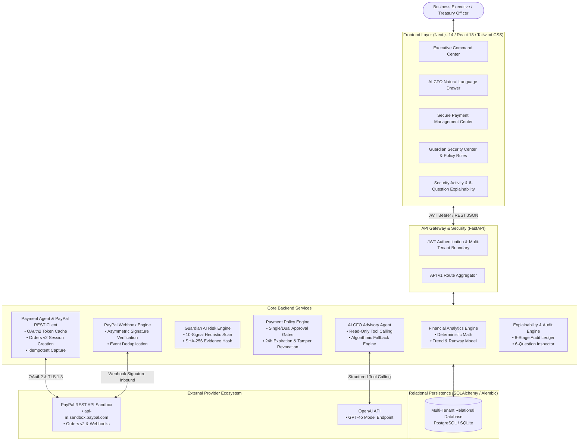
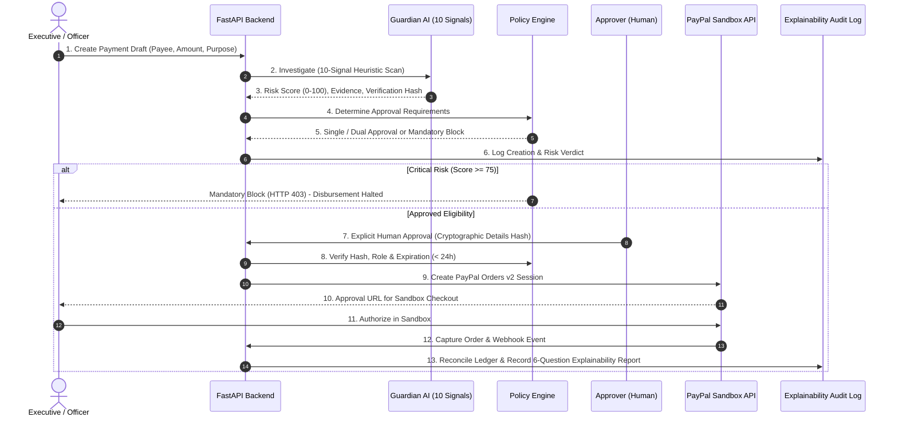
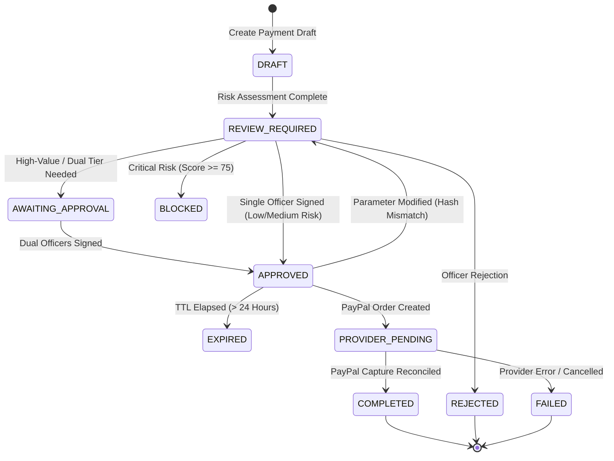

# Guardian CFO: System Architecture & Design Specification

**Project:** Guardian CFO — The AI CFO That Thinks Before It Pays  
**Version:** 1.0.0 (Production Candidate)  
**Target:** PayPal AI Hackathon 2026  

---

## 1. System Overview

**Guardian CFO** is an autonomous financial intelligence, cash flow analytics, and payment security platform designed to protect small and medium businesses (SMBs) from fraudulent disbursements, unauthorized supplier payments, and cash runway depletion. 

Unlike conventional financial dashboards or generic conversational chatbots, Guardian CFO combines **deterministic Python ledger analytics**, an **AI CFO advisory agent**, a **10-signal deterministic payment risk detection engine**, and an **immutable cryptographic approval pipeline** integrated with the **PayPal REST API (Orders v2)**.

---

## 2. The 8-Stage Zero-Trust Decision Cycle

Guardian CFO enforces an autonomous 8-stage zero-trust decision cycle for all disbursements:

$$\text{Understand} \longrightarrow \text{Analyze} \longrightarrow \text{Investigate} \longrightarrow \text{Decide} \longrightarrow \text{Approve} \longrightarrow \text{Pay} \longrightarrow \text{Monitor} \longrightarrow \text{Explain}$$

---

## 3. Core Architectural Modules

### 3.1. Financial Analytics Engine (Zero Hallucination)
- **Deterministic Pure Math**: Implemented entirely in Python without statistical guessing or LLM approximation.
- **Formulas**:
  $$\text{Net Cash Flow} = \text{Total Revenue} - \text{Total Expenses}$$
  $$\text{Expense Change (\%)} = \left(\frac{\text{Current Expense} - \text{Previous Expense}}{\text{Previous Expense}}\right) \times 100$$
  $$\text{Revenue Growth (\%)} = \left(\frac{\text{Current Revenue} - \text{Previous Revenue}}{\text{Previous Revenue}}\right) \times 100$$
- **Zero-Division & Missing Data Handling**: If prior revenue or expense is 0, percentage change returns `0.0%` safely without raising division errors.
- **Runway Modeling**: Calculates daily burn rate ($\frac{\text{Monthly Budget}}{30}$) and computes treasury runway impact in days and months.

### 3.2. AI CFO Intelligent Advisory Agent
- **Strict Read-Only Authority**: Operates solely with approved analytics tools (`get_financial_summary`, `get_category_breakdown`, `get_top_vendors`, `check_affordability`, `compare_periods`, `get_unusual_spending_patterns`, `get_recurring_commitments`).
- **Prompt Injection Defense**: Adversarial prompts attempting to modify balances, trigger payments, or alter draft statuses are neutralized. Unauthorized tool names raise `ValueError("Unauthorized or unknown CFO tool")`.
- **Hybrid Engine**:
  1. *Online Mode*: OpenAI GPT-4o with structured JSON tool-calling.
  2. *Offline / Fallback Mode*: Deterministic algorithmic parser executing identical database tools and generating structured markdown insights with zero cloud dependencies.

### 3.3. Guardian AI: 10-Signal Risk Engine
Deterministic Python heuristic engine auditing proposed invoices against 10 discrete signals:
1. **First-Time Vendor** (+20.0 pts): Checks for lack of historical settlements.
2. **Unusual Payment Amount** (+25.0 pts): Flags statistical outliers exceeding 2.5x vendor average.
3. **Duplicate Invoice** (+35.0 pts): Detects matching invoice numbers across historical drafts.
4. **Duplicate Payment Velocity** (+30.0 pts): Flags identical payouts to the same payee within 72 hours.
5. **Unusual Payment Frequency** (+20.0 pts): Identifies bursts (> 3 requests within 7 days).
6. **Vendor Information Mismatch** (+30.0 pts): Catches brand spoofing on untrusted/generic domains.
7. **Payment Exceeding Business Limits** (+25.0 pts): Enforces company single-payment ceilings.
8. **Unusual Category Spending** (+20.0 pts): Flags category outflow spikes (> 40% surge).
9. **Unusual Transaction Timing** (+15.0 pts): Detects weekend or off-hours draft submissions.
10. **Missing Vendor Verification** (+15.0 pts): Flags unverified domains and missing contact information.

- **Integrity Digest**: Computes a SHA-256 `verification_hash` over the detected signals and scores.

### 3.4. Payment Policy Engine
- **Configurable Risk Thresholds**:
  - `LOW (0–24)`: `SAFE_TO_PAY` $\rightarrow$ Standard single-officer approval.
  - `MEDIUM (25–49)`: `REQUIRES_MANUAL_REVIEW` $\rightarrow$ Mandatory review with rationale.
  - `HIGH (50–74)`: `REQUIRES_DUAL_EXECUTIVE_APPROVAL` $\rightarrow$ Enforced dual sign-off.
  - `CRITICAL (75–100)`: `BLOCKED` $\rightarrow$ Immediate halt; unilateral override forbidden.
- **Cryptographic Details Fingerprinting**:
  $$\text{details\_hash} = \text{SHA256}(\text{vendor\_id} \parallel \text{amount} \parallel \text{currency} \parallel \text{purpose} \parallel \text{invoice\_number})$$
  Any parameter modification after approval revokes the authorization and resets status to `REVIEW_REQUIRED`.
- **24-Hour Expiration TTL**: Approvals older than 24 hours automatically expire.

### 3.5. PayPal REST API Integration
- **OAuth2 Token Cache**: Caches Bearer tokens with a 60-second expiration buffer to prevent rate limiting.
- **Orders v2 Creation**: Submits `intent: "CAPTURE"`, returning authentic PayPal approval URLs.
- **Sandboxed Execution**: Enforces `is_sandbox=True` and records PayPal Order ID and Capture ID.
- **Truthful Telemetry**: If credentials are missing in development, returns `HTTP 400` with `paypal_not_configured` without fabricating false transactions.

### 3.6. PayPal Webhook Processing & Reconciliation
- **Signature Verification**: Validates `paypal-transmission-sig`, `paypal-cert-url`, `paypal-transmission-id`, and `paypal-transmission-time` against PayPal's verification procedures.
- **Idempotent Deduplication**: Checks `webhook_events.event_id` before processing to prevent double-settlement.
- **Event Reconciliation**: Listens for `CHECKOUT.ORDER.APPROVED` and `PAYMENT.CAPTURE.COMPLETED` to transition draft and transaction states.

### 3.7. Explainability & Audit Engine
- **Searchable Audit Ledger**: Records all 8 stages with timestamp, user ID, actor, and rationale.
- **6-Question Transparent Inspector**:
  1. *What happened?*
  2. *Why was it flagged?*
  3. *What evidence was detected?*
  4. *What action was taken?*
  5. *Who approved or rejected it?*
  6. *What is the final provider status?*

---

## 4. Payment State Machine

---

## 5. Security Invariants

1. **No Plaintext Passwords**: Passwords hashed using `bcrypt` ($12$ rounds with automatic salt).
2. **Zero Secret Leakage**: Database URLs, PayPal client secrets, and OpenAI keys are never returned in API payloads or telemetry logs.
3. **Fail-Closed Execution**: If any security check, policy validation, or webhook signature check is indeterminate or fails, payment disbursement is denied immediately.
4. **Tenant Isolation**: All database queries are filtered by `business_id` derived exclusively from cryptographically verified JWT claims. Cross-tenant access attempts return `HTTP 404`.

