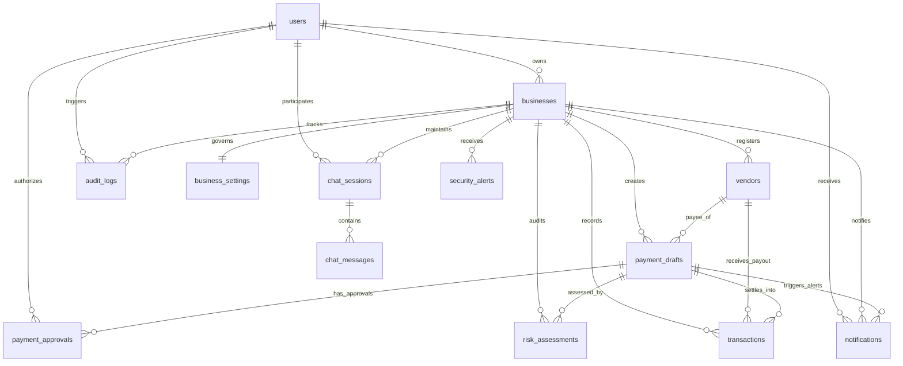

# Guardian CFO: Database Schema & Entity-Relationship Model

**Database Support:** PostgreSQL (psycopg3) standard | SQLite local zero-config development  
**ORM:** SQLAlchemy 2.0  
**Migration Engine:** Alembic (Head: `8f20b345a1c2`)  

---

## 1. Entity-Relationship (ER) Diagram

---

## 2. Table Specifications (14 Tables)

### 2.1. `users`
Stores user credentials, organizational roles, and active states.
| Column | Type | Constraints | Description |
|:---|:---|:---|:---|
| `id` | Integer | PK, Auto-increment | Unique user identifier |
| `email` | String(255) | Unique, Index, Not Null | Normalized login email address |
| `hashed_password` | String(255) | Not Null | Salted bcrypt hash ($12$ rounds) |
| `full_name` | String(255) | Not Null | User's legal/display name |
| `role` | String(50) | Not Null, Default: 'OWNER' | Role (`OWNER`, `CONTROLLER`, `AUDITOR`) |
| `is_active` | Boolean | Not Null, Default: True | Account active status flag |
| `created_at` | DateTime | Not Null | Account creation timestamp (UTC) |
| `updated_at` | DateTime | Nullable | Last profile update timestamp |

---

### 2.2. `businesses`
Represents isolated tenant business accounts.
| Column | Type | Constraints | Description |
|:---|:---|:---|:---|
| `id` | Integer | PK, Auto-increment | Unique business identifier |
| `name` | String(255) | Index, Not Null | Operating brand / company name |
| `legal_name` | String(255) | Nullable | Registered corporate legal entity name |
| `currency` | String(10) | Not Null, Default: 'USD' | Primary treasury currency (ISO 4217) |
| `tax_id` | String(50) | Nullable | Federal/corporate tax identification |
| `total_balance` | Float | Not Null, Default: 0.0 | Verified cash reserve / treasury balance |
| `monthly_budget` | Float | Not Null, Default: 50000.0 | Operating expense budget allocation |
| `monthly_spent` | Float | Not Null, Default: 0.0 | Cumulative spend in current billing cycle |
| `owner_id` | Integer | FK(`users.id`), Index | User owning and administering business |
| `created_at` | DateTime | Not Null | Business onboarding timestamp |
| `updated_at` | DateTime | Nullable | Last balance or budget update timestamp |

---

### 2.3. `business_settings`
Configurable governance thresholds and policy rules per business tenant.
| Column | Type | Constraints | Description |
|:---|:---|:---|:---|
| `id` | Integer | PK, Auto-increment | Unique settings identifier |
| `business_id` | Integer | FK(`businesses.id`), Unique, Not Null | Associated business tenant |
| `auto_approve_threshold` | Float | Not Null, Default: 250.0 | Max amount eligible for auto-approval |
| `max_single_payment_limit`| Float | Not Null, Default: 5000.0 | Hard ceiling for single transaction |
| `require_dual_approval_above`| Float | Not Null, Default: 1000.0 | Threshold triggering dual executive sign-off |
| `risk_tolerance_level` | String(50) | Not Null, Default: 'MEDIUM'| Risk appetite (`LOW`, `MEDIUM`, `HIGH`) |
| `notification_email` | String(255) | Nullable | Primary alert dispatch address |
| `enable_paypal_sandbox` | Boolean | Not Null, Default: True | Sandbox vs simulated execution toggle |
| `updated_at` | DateTime | Nullable | Last policy change timestamp |

---

### 2.4. `vendors`
Approved and pending supplier directory with trust telemetry.
| Column | Type | Constraints | Description |
|:---|:---|:---|:---|
| `id` | Integer | PK, Auto-increment | Unique vendor identifier |
| `business_id` | Integer | FK(`businesses.id`), Index, Not Null | Owning business tenant |
| `name` | String(255) | Index, Not Null | Vendor company/trading name |
| `email` | String(255) | Index, Not Null | Vendor billing/invoicing email |
| `website` | String(255) | Nullable | Official vendor corporate website |
| `bank_or_paypal_email` | String(255) | Nullable | Disburse endpoint (PayPal email/account) |
| `status` | String(50) | Not Null, Default: 'ACTIVE'| Payee status (`ACTIVE`, `UNDER_REVIEW`, `BLOCKED`) |
| `trust_score` | Float | Not Null, Default: 65.0 | Algorithmic domain & history trust score (0–100) |
| `total_paid` | Float | Not Null, Default: 0.0 | Cumulative historical disbursements |
| `created_at` | DateTime | Not Null | Vendor registration timestamp |

---

### 2.5. `payment_drafts`
Proposed invoices undergoing review, risk scoring, and authorization.
| Column | Type | Constraints | Description |
|:---|:---|:---|:---|
| `id` | Integer | PK, Auto-increment | Unique draft identifier |
| `business_id` | Integer | FK(`businesses.id`), Index, Not Null | Owning business tenant |
| `vendor_id` | Integer | FK(`vendors.id`), Index, Not Null | Target payee vendor |
| `created_by_id` | Integer | FK(`users.id`), Nullable | Initiating user identifier |
| `title` | String(255) | Not Null | Short descriptive payment title |
| `amount` | Float | Not Null | Gross payment amount |
| `currency` | String(10) | Not Null, Default: 'USD' | Payment currency (ISO 4217) |
| `category` | String(100) | Not Null | Spending bucket (e.g. Infrastructure) |
| `purpose` | Text | Nullable | Commercial rationale for payment |
| `invoice_number` | String(100) | Index, Nullable | Vendor invoice reference code |
| `invoice_url` | String(500) | Nullable | Direct URL or path to attached invoice PDF |
| `description` | Text | Nullable | Detailed line-item breakdown |
| `status` | String(50) | Index, Not Null | State machine status (e.g. `REVIEW_REQUIRED`) |
| `cfo_recommendation` | String(50) | Nullable | AI advisory recommendation (`APPROVE`, `FLAG`) |
| `cfo_rationale` | Text | Nullable | AI CFO treasury impact explanation |
| `budget_impact_pct` | Float | Nullable | Share of monthly budget consumed (%) |
| `runway_impact_days` | Integer | Nullable | Estimated runway consumed in operating days |
| `details_hash` | String(64) | Index, Nullable | SHA-256 fingerprint locking approved fields |
| `idempotency_key` | String(100) | Index, Nullable | Deduplication key preventing repeat draft creation |
| `approved_at` | DateTime | Nullable | Timestamp of primary approval |
| `approved_by_id` | Integer | FK(`users.id`), Nullable | User ID of primary approver |
| `expires_at` | DateTime | Nullable | Expiration timestamp (24-hour TTL) |
| `requires_dual_approval`| Boolean | Default: False | Flag indicating dual-control mandate |
| `secondary_approved_at` | DateTime | Nullable | Timestamp of secondary approval |
| `secondary_approved_by_id`| Integer | FK(`users.id`), Nullable | User ID of secondary approver |
| `rejection_reason` | Text | Nullable | Explanatory note if rejected |
| `created_at` | DateTime | Not Null | Creation timestamp |
| `updated_at` | DateTime | Nullable | Last modification timestamp |

---

### 2.6. `payment_approvals`
Individual cryptographic audit records for approvals and rejections.
| Column | Type | Constraints | Description |
|:---|:---|:---|:---|
| `id` | Integer | PK, Auto-increment | Unique approval audit identifier |
| `payment_draft_id` | Integer | FK(`payment_drafts.id`), Index | Targeted payment draft |
| `approved_by_id` | Integer | FK(`users.id`), Index | Authorizing officer user ID |
| `approval_role` | String(50) | Not Null | Role (`PRIMARY_APPROVER`, `SECONDARY_APPROVER`, `REJECTION`) |
| `notes` | Text | Nullable | Signer's verification notes |
| `details_hash` | String(64) | Not Null | SHA-256 fingerprint verified at signing |
| `approved_at` | DateTime | Not Null | Timestamp of signature |

---

### 2.7. `transactions`
Immutable ledger of completed, pending, and failed disbursements.
| Column | Type | Constraints | Description |
|:---|:---|:---|:---|
| `id` | Integer | PK, Auto-increment | Unique transaction identifier |
| `business_id` | Integer | FK(`businesses.id`), Index, Not Null | Owning business tenant |
| `vendor_id` | Integer | FK(`vendors.id`), Index, Nullable | Payee vendor (for expenses) |
| `payment_draft_id` | Integer | FK(`payment_drafts.id`), Nullable | Associated originating draft |
| `transaction_type` | String(20) | Not Null | `INCOME` or `EXPENSE` |
| `amount` | Float | Not Null | Settled payment amount |
| `currency` | String(10) | Not Null, Default: 'USD' | Transaction currency |
| `status` | String(50) | Index, Not Null | Status (`COMPLETED`, `PROVIDER_PENDING`, `FAILED`) |
| `category` | String(100) | Not Null | Categorization taxonomy |
| `description` | Text | Nullable | Line-item description |
| `is_recurring` | Boolean | Default: False | Flag for recurring subscription |
| `recurring_frequency` | String(50) | Nullable | Frequency (`MONTHLY`, `ANNUAL`) |
| `paypal_order_id` | String(100) | Index, Nullable | PayPal Orders v2 Order ID |
| `paypal_capture_id` | String(100) | Index, Nullable | PayPal Capture confirmation ID |
| `is_sandbox` | Boolean | Default: True | Sandbox vs live indicator |
| `settled_at` | DateTime | Nullable | Provider settlement confirmation timestamp |
| `created_at` | DateTime | Not Null | Record creation timestamp |

---

### 2.8. `risk_assessments`
10-signal heuristic evaluation records with cryptographic verification hashes.
| Column | Type | Constraints | Description |
|:---|:---|:---|:---|
| `id` | Integer | PK, Auto-increment | Unique risk assessment identifier |
| `payment_draft_id` | Integer | FK(`payment_drafts.id`), Index | Associated payment draft |
| `business_id` | Integer | FK(`businesses.id`), Index, Not Null | Owning business tenant |
| `risk_score` | Float | Not Null | Composite threat score (0.0–100.0) |
| `risk_level` | String(20) | Not Null | Category (`LOW`, `MEDIUM`, `HIGH`, `CRITICAL`) |
| `verdict` | String(50) | Not Null | Verdict (e.g. `SAFE_TO_PAY`, `BLOCKED`) |
| `recommended_action` | String(50) | Not Null | Prescribed action (e.g. `ALLOW`, `REJECT_AND_BLOCK`) |
| `plain_explanation` | Text | Not Null | Natural-language explanation of findings |
| `risk_signals` | Text / JSON | Not Null | JSON list of detected risk signals and weights |
| `supporting_evidence` | Text / JSON | Not Null | JSON list of evidence citations |
| `missing_information` | Text / JSON | Not Null | JSON list of unverified data points |
| `vendor_verified` | Boolean | Default: False | Payee verification status |
| `is_duplicate_invoice` | Boolean | Default: False | Duplicate invoice indicator |
| `verification_hash` | String(64) | Index, Not Null | SHA-256 digest over signals and scores |
| `created_at` | DateTime | Not Null | Assessment timestamp |

---

### 2.9. `security_alerts`
High-priority security alerts generated for elevated or critical risk payments.
| Column | Type | Constraints | Description |
|:---|:---|:---|:---|
| `id` | Integer | PK, Auto-increment | Unique alert identifier |
| `business_id` | Integer | FK(`businesses.id`), Index, Not Null | Owning business tenant |
| `payment_draft_id` | Integer | FK(`payment_drafts.id`), Nullable | Associated flagged draft |
| `title` | String(255) | Not Null | Alert summary headline |
| `severity` | String(20) | Index, Not Null | Severity (`LOW`, `MEDIUM`, `HIGH`, `CRITICAL`) |
| `message` | Text | Not Null | Detailed risk description |
| `status` | String(50) | Index, Not Null | Status (`OPEN`, `RESOLVED`, `DISMISSED`) |
| `created_at` | DateTime | Not Null | Alert dispatch timestamp |
| `resolved_at` | DateTime | Nullable | Resolution timestamp |

---

### 2.10. `audit_logs`
Immutable compliance ledger tracking actions across all 8 pipeline stages.
| Column | Type | Constraints | Description |
|:---|:---|:---|:---|
| `id` | Integer | PK, Auto-increment | Unique audit log identifier |
| `business_id` | Integer | FK(`businesses.id`), Index, Not Null | Owning business tenant |
| `user_id` | Integer | FK(`users.id`), Index, Nullable | Initiating user ID |
| `decision_id` | Integer | Nullable | Associated payment draft ID |
| `stage` | String(50) | Index, Not Null | Pipeline stage (`UNDERSTAND`, `APPROVE`, `PAY`) |
| `actor` | String(100) | Not Null | Actor (`USER`, `AI_CFO`, `GUARDIAN_AI`, `SYSTEM`) |
| `action` | String(100) | Index, Not Null | Action code (e.g. `PAYMENT_APPROVED`, `POLICY_VIOLATION`) |
| `summary` | Text | Not Null | Human-readable event summary |
| `details` | Text | Nullable | Extended technical metadata or capture ID |
| `rationale` | Text | Nullable | Business or governance rationale |
| `timestamp` | DateTime | Index, Not Null | Audit event timestamp |

---

### 2.11. `chat_sessions`
Contextual multi-turn AI CFO consultation sessions.
| Column | Type | Constraints | Description |
|:---|:---|:---|:---|
| `id` | Integer | PK, Auto-increment | Unique session identifier |
| `business_id` | Integer | FK(`businesses.id`), Index, Not Null | Owning business tenant |
| `user_id` | Integer | FK(`users.id`), Index, Not Null | Consulting user ID |
| `title` | String(255) | Not Null | Conversation title |
| `created_at` | DateTime | Not Null | Session creation timestamp |
| `updated_at` | DateTime | Nullable | Last message timestamp |

---

### 2.12. `chat_messages`
Individual dialog turns with role and tool reasoning metadata.
| Column | Type | Constraints | Description |
|:---|:---|:---|:---|
| `id` | Integer | PK, Auto-increment | Unique message identifier |
| `session_id` | Integer | FK(`chat_sessions.id`), Index | Owning chat session |
| `role` | String(20) | Not Null | Message role (`user`, `assistant`, `system`) |
| `content` | Text | Not Null | Message content in markdown |
| `reasoning_meta` | Text / JSON | Nullable | JSON metadata of tools executed and cards |
| `created_at` | DateTime | Not Null | Message timestamp |

---

### 2.13. `webhook_events`
Idempotent PayPal webhook processing and audit records.
| Column | Type | Constraints | Description |
|:---|:---|:---|:---|
| `id` | Integer | PK, Auto-increment | Unique internal webhook log ID |
| `event_id` | String(100) | Unique, Index, Not Null | PayPal Webhook Event ID (`WH-EVT-...`) |
| `event_type` | String(100) | Index, Not Null | Event type (e.g. `PAYMENT.CAPTURE.COMPLETED`) |
| `business_id` | Integer | FK(`businesses.id`), Nullable | Reconciled business tenant |
| `payment_draft_id` | Integer | FK(`payment_drafts.id`), Nullable | Reconciled draft ID |
| `signature_verified`| Boolean | Not Null, Default: False | Signature verification outcome |
| `processed` | Boolean | Not Null, Default: False | Processing completion flag |
| `payload` | Text / JSON | Not Null | Full raw webhook JSON payload |
| `created_at` | DateTime | Not Null | Received timestamp |

---

### 2.14. `notifications`
Real-time user notification and alert stream.
| Column | Type | Constraints | Description |
|:---|:---|:---|:---|
| `id` | Integer | PK, Auto-increment | Unique notification identifier |
| `business_id` | Integer | FK(`businesses.id`), Index, Not Null | Owning business tenant |
| `user_id` | Integer | FK(`users.id`), Index, Nullable | Target user (null for tenant-wide) |
| `payment_draft_id` | Integer | FK(`payment_drafts.id`), Nullable | Linked payment draft |
| `type` | String(50) | Index, Not Null | Type (`PAYMENT_HIGH_RISK`, `PAYMENT_COMPLETED`) |
| `severity` | String(20) | Not Null, Default: 'INFO' | Severity (`INFO`, `WARNING`, `CRITICAL`) |
| `title` | String(255) | Not Null | Notification title |
| `message` | Text | Not Null | Notification body text |
| `is_read` | Boolean | Index, Not Null, Default: False | Read status flag |
| `created_at` | DateTime | Index, Not Null | Notification dispatch timestamp |

